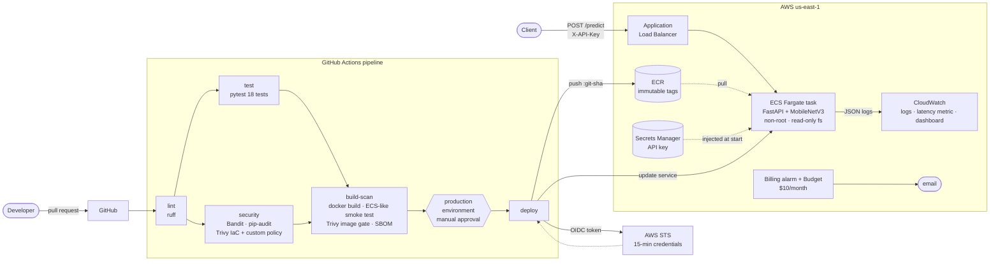

# secure-ml-inference

A PyTorch image classifier served by FastAPI on **AWS ECS Fargate**, shipped by a **DevSecOps
pipeline**. Every change is linted, tested, and scanned for code, dependency, container, and
infrastructure issues. HIGH/CRITICAL findings block the build. Deploys need a human approval and
use **GitHub OIDC**, so there are **no long-lived AWS keys anywhere**. All infrastructure is
Terraform, and one script tears it all down and verifies nothing is left.

Every number below was measured on this repo. The [found and fixed](#found-and-fixed) section
covers the real problems the pipeline and testing caught along the way.

## Results

| Metric | Result |
|---|---|
| **Image size** (compressed, as stored in ECR) | 6,555 MB naive → **297 MB** multi-stage (−95%) |
| Image size (unpacked on disk) | 9,587 MB → **988 MB** (−90%) |
| **Image HIGH / CRITICAL CVEs** (Trivy, identical flags) | 314 / 16 → **44 / 0** |
| Fixable HIGH / CRITICAL (the CI gate) | **0 / 0** |
| Dependency vulnerabilities (pip-audit) | 4 found in the first lock → **0** |
| **Latency on AWS**, client-side, 300 requests @ concurrency 4 | **p50 218 ms · p95 395 ms · p99 504 ms** |
| Server-side /predict latency (app metric) | p50 198 ms · p95 343 ms · p99 405 ms |
| Throughput (1 task, 0.5 vCPU) | 16.3 req/s, 300/300 OK |
| Single-request service time (local, 0.5 CPU, concurrency 1) | p50 78 ms |
| **Deploy time** (approval → new task healthy behind the ALB) | **232 s** |
| Pipeline, push → production (excluding approval wait) | ~7 min |
| Unit + integration tests | 18 passing, 98.6% coverage (gate: 90%) |

<details>
<summary>How to read the latency numbers</summary>

The three layers agree: client 218 ms ≈ ALB 208 ms ≈ app 198 ms at p50. The internet and the
load balancer add about 10 ms each; the rest is model inference. One request takes about 78 ms
of CPU. At concurrency 4, the extra latency is queueing: ECS CPU hit 100% (memory 28%), so a
0.5 vCPU task saturates around 12–16 req/s. More traffic needs more tasks (horizontal scaling),
not more threads.

Raw data: [`results/findings.md`](results/findings.md), [`results/loadtest-aws.json`](results/loadtest-aws.json),
[`results/image_report.md`](results/image_report.md).
</details>

## Architecture



**Request path:** client → ALB (port 80) → Fargate task (port 8000; its security group only
accepts traffic from the ALB) → MobileNetV3-Small → top-5 ImageNet labels.

## What it demonstrates

**Service.** FastAPI with `GET /health` (unauthenticated, for the ALB) and `POST /predict`
(requires an `X-API-Key` header, checked in constant time). Uploads are validated by content type,
a 5 MB size cap, and decompression-bomb protection. Inference runs in a threadpool so the event
loop stays responsive. Each request is logged as one JSON line with `latency_ms`. The model is
torchvision **MobileNetV3-Small** (ImageNet-1k), with weights baked into the image at build time
and hash-checked by torchvision.

**Container.** A multi-stage Dockerfile: slim Debian base pinned by digest, dependencies installed
with `pip --require-hashes` from a fully hashed lock, CPU-only torch, and torch headers, tests and
pip stripped after install. Runs as **uid 10001** with a **read-only root filesystem**,
**all Linux capabilities dropped**, and `no-new-privileges`. No server header.

**Pipeline** ([`.github/workflows/pipeline.yml`](.github/workflows/pipeline.yml)):

| Stage | Tooling | Fails the build on |
|---|---|---|
| Lint | ruff (incl. security rules), format check | any finding |
| Test | pytest, coverage | failure or coverage < 90% |
| Code scan | Bandit | HIGH severity |
| Dependency scan | pip-audit, two passes (see below) | any known vulnerability |
| IaC scan | Trivy config + custom Rego policy [`SMI-0001`](policies/no_public_ingress_non_web.rego) | HIGH/CRITICAL |
| Container smoke test | runs the image the way ECS will | unhealthy / misconfigured `/tmp` |
| Image scan | Trivy (results also uploaded to GitHub code scanning) | fixable HIGH/CRITICAL |
| SBOM | Trivy → CycloneDX artifact (90 days) | — |
| Deploy | OIDC → ECR → ECS, waits for stability, smoke-tests the ALB | rollout or health failure |

**Supply chain.**
- All 9 third-party actions are pinned to full commit SHAs, each verified to exist and to be at least 14 days old.
- Trivy runs from an image pinned by version and digest, not through `trivy-action` (whose tags were hijacked in March 2026).
- Dependabot keeps pip, actions, the Docker base image and Terraform providers current, with a 14-day cooldown.
- The image that's deployed is the exact tarball that was scanned. Nothing is rebuilt in between.

**Workflow hardening.**
- Read-only `GITHUB_TOKEN` by default; only the deploy job can request an OIDC token.
- Repo variables reach shell scripts through `env:`, never `${{ }}` interpolation.
- Verified clean with **actionlint** and **zizmor** (0 high, medium or low findings).

**Gates that actually gate.**
- A branch ruleset on `main` requires a PR and the lint, test, security and build-scan checks.
- The `production` environment requires a reviewer.
- The AWS role's trust policy accepts only this repo's `production` environment, matched by immutable repo ID.

**Infrastructure** ([`infra/`](infra/)): two Terraform stacks.
- `bootstrap`, applied first: billing alarm plus budget.
- `main`: VPC, ALB, ECS, ECR, IAM, OIDC, Secrets Manager and CloudWatch.

Least-privilege IAM:

| Role | Can do |
|---|---|
| Execution role (ECS agent) | pull from *this* repo, write to *this* log group, read *this* secret |
| Task role (app code) | **nothing**: the app calls no AWS APIs |
| GitHub deploy role | push to *this* repo, update *this* service, pass only *these* two roles to ECS |

`Resource = "*"` appears only where AWS requires it, with a comment saying so.

**Secrets.** The API key lives only in Secrets Manager. Terraform creates the empty secret; the
value is set once from the CLI, so it never appears in Terraform state, the repo, the image, or the
task definition. ECS injects it as an env var at task start. Locally it comes from `.env`
(gitignored; see [`.env.example`](.env.example)).

**Monitoring.** A CloudWatch dashboard shows ALB p50/p95/p99 latency, app-measured `/predict`
p50/p95/p99 (via a log metric filter on `latency_ms`), request and error counts, healthy targets,
ECS CPU/memory, and a Logs Insights percentile table.

## Found and fixed

The real problems this project surfaced, in the order they came up.

1. **Stale, vulnerable packages from the PyTorch index.** The first lock picked up
   `setuptools 78.1.0` (CVE-2025-47273, path traversal) and `idna 3.4` from PyTorch's package
   mirror, which hosts old copies of common packages. pip-audit failed it with 4 advisories.
   Fixed by pinning the `+cpu` torch builds explicitly and resolving everything else across both
   indexes (`--index-strategy unsafe-best-match`), with hashes locking every artifact.

2. **pip-audit silently skipped torch.** `torch 2.14.1+cpu` doesn't exist on PyPI, so pip-audit
   reported it as "could not be audited" and passed. [`scripts/audit_deps.sh`](scripts/audit_deps.sh)
   adds a second pass with `+cpu` stripped (same source release). Positive control:
   an old `torch==2.2.0` is caught with 23 advisories.

3. **A workflow that GitHub would have rejected.** actionlint caught an unquoted colon in a step
   name that broke YAML parsing. zizmor flagged two template-injection sinks
   (`${{ vars.* }}` inside `run:`), now passed through `env:`.

4. **Trivy's public-ingress check has a blind spot.** While verifying that every
   `#trivy:ignore` was actually needed, one turned out to suppress nothing. Testing showed Trivy
   0.74's AWS-0107 only fires for ports 22/3389: a rule opening the app port to `0.0.0.0/0`
   produced only LOW findings and would have **passed CI**. Closed with a custom Rego policy,
   [`SMI-0001`](policies/no_public_ingress_non_web.rego) (CRITICAL; public ingress only on
   80/443). Tested against all three Terraform rule styles, including IPv6.

5. **OIDC trust rejected GitHub's real token.** The first deploy got `AccessDenied`. CloudTrail
   showed GitHub's `sub` claim now embeds immutable IDs
   (`repo:Shaho912@165518672/secure-ml-inference@1414836101:environment:production`). The trust
   policy now matches that exactly, not with a wildcard, so a deleted-and-recreated repo with the
   same name can't deploy.

6. **A crash that only happened on Fargate.** Tasks exited with code 3. Logs showed torch's
   import needs a writable temp dir, and ECS mounts task volumes as `root:root 0755` unless the
   image declares a matching `VOLUME`. The local test used `--tmpfs` (mode 1777), which hid it.
   Reproduced locally with a root-owned 0755 mount and fixed (`/tmp` owned by the app user,
   `VOLUME ["/tmp"]`). A new CI **ECS-like smoke test** now catches it; verified it fails on the
   broken image.

7. **`terraform destroy` wasn't actually complete.** CI registers a new task-definition
   revision per deploy, and Terraform only knows the first. [`scripts/teardown.sh`](scripts/teardown.sh)
   destroys, removes the leftover revisions, and checks that 14 resource types are gone.

Smaller ones: the baseline image's Trivy scan exceeded the default 5-minute timeout (both images
now scan with `--timeout 20m`); `.gitignore` didn't cover plan files saved as `tfplan`; and AWS's
normalization of the ECS container definition caused a phantom `plan` diff.

## Cost

Measured against the AWS Price List API (us-east-1, October 2026).

| Resource | Price | Approx. per day |
|---|---|---|
| Application Load Balancer | $0.0225/hr + LCUs | $0.73 |
| Fargate task (0.5 vCPU, 1 GB) | $0.04048/vCPU-hr + $0.004445/GB-hr | $0.59 |
| Public IPv4 ×3 (ALB ×2, task ×1) | $0.005/hr each | $0.36 |
| Secrets Manager (1 secret) | $0.40/month | $0.01 |
| ECR (~0.3 GB), CloudWatch logs, dashboard, metric | within free allowances | ~$0 |
| VPC, IAM, OIDC, ECS cluster, billing alarm, budget | free | $0 |

**About $1.70/day while running.** The whole build-measure-destroy cycle for this README cost
well under $1. There's **no NAT gateway** (it would add ~$32/month); see limitations. The billing
alarm and the budget's forecast alert email before spend passes $10/month.

## Known limitations

These are deliberate trade-offs for a short-lived, low-cost demo, each with its upgrade path.

| Limitation | Why | Production fix |
|---|---|---|
| **HTTP only.** The API key crosses the internet unencrypted. | No domain; ACM certificates need one. Trivy AWS-0054 accepted inline. | Route 53 domain + ACM cert, HTTPS listener, HTTP→HTTPS redirect. |
| **Tasks have public IPs** in public subnets. | Avoids a ~$32/month NAT gateway. Inbound is still ALB-only (security group), and SMI-0001 enforces it. | Private subnets + VPC endpoints (ECR, Logs, Secrets Manager) or a NAT gateway. |
| **Task egress is 443 to 0.0.0.0/0.** | No fixed IP ranges for AWS endpoints without VPC endpoints. Trivy AWS-0104 accepted inline. | VPC endpoints + prefix-list-scoped egress. |
| **CI gate uses `--ignore-unfixed`.** It fails only on CVEs with a fix available. | Unfixed CVEs can't be patched by us. The **44 unfixed HIGHs** are all Debian base packages (util-linux, ncurses, systemd libs). Both counts are reported above. | Distroless or Wolfi-based Python runtime image. |
| **pip-audit can't see `+cpu` builds natively.** | They exist only on PyTorch's index. | Mitigated by the second audit pass and Trivy's image scan. |
| **Single task, no autoscaling.** | Cost. One 0.5 vCPU task saturates around 16 req/s. | ECS service autoscaling on CPU or ALB request count. |
| **AWS-managed encryption keys**, no VPC flow logs, no Container Insights | Each customer-managed KMS key is $1/month; flow logs and Insights bill per GB/metric. (Trivy LOW/MEDIUM, non-gating.) | Customer-managed KMS keys, flow logs to S3. |
| **Billing SNS topic unencrypted** | CloudWatch alarms can't publish to a topic using the AWS-managed `aws/sns` key. Trivy AWS-0095 accepted inline. | Customer-managed KMS key with a CloudWatch grant. |
| **Local Terraform state** | CI never runs Terraform, so there's no second writer. | S3 backend with native locking once more than one person applies. |
| **First rollback target is a placeholder.** Before the first good deploy, a circuit-breaker rollback lands on Terraform's `:bootstrap` revision, whose image is never pushed. | Terraform creates the service before any image exists. | Push an initial image before the first `apply`, or create the service at desired count 0 (as here) and accept this on day one. |

## Setup

Prerequisites: an AWS account (sign in via IAM Identity Center, not access keys), Terraform ≥ 1.10,
the AWS CLI v2, Docker, Python 3.12+, and a **public** GitHub repo (required reviewers on
environments are free for public repos).

<details>
<summary><b>1. Run locally</b></summary>

```bash
python -m venv .venv && .venv/Scripts/python -m pip install uv     # .venv/bin on macOS/Linux
.venv/Scripts/uv pip install --python .venv/Scripts/python.exe --index-strategy unsafe-best-match \
  -r requirements.in -r requirements-dev.in
cp .env.example .env            # set API_KEY (16+ chars)
.venv/Scripts/python -m pytest  # 18 tests

docker build -f docker/Dockerfile -t secure-ml-inference:final .
docker run --rm -p 8000:8000 -e API_KEY=change-me-to-16-chars-plus \
  --read-only --mount type=volume,dst=/tmp --cap-drop ALL secure-ml-inference:final
curl -H "X-API-Key: change-me-to-16-chars-plus" -F "file=@cat.jpg;type=image/jpeg" localhost:8000/predict
```
</details>

<details>
<summary><b>2. Billing guardrails first</b> (<code>infra/bootstrap</code>, $0)</summary>

1. Billing console → Billing preferences → enable **Receive CloudWatch billing alerts**.
2. `cp infra/bootstrap/example.tfvars infra/bootstrap/terraform.tfvars`, then set `alert_email`.
3. Apply:
   ```bash
   aws sso login
   cd infra/bootstrap && terraform init && terraform apply
   ```
4. Click the confirmation link AWS emails you.
</details>

<details>
<summary><b>3. Main stack</b> (<code>infra/main</code>, ~$1/day before the first deploy)</summary>

Set `github_repo`, `github_owner_id`, and `github_repo_id` in
[`variables.tf`](infra/main/variables.tf) (get the IDs from `https://api.github.com/repos/<owner>/<repo>`). Then:

```bash
cd infra/main && terraform init && terraform apply     # 32 resources
terraform output github_actions_variables
```

Set the API key (PowerShell shown; it never touches a file):
```powershell
$key = python -c "import secrets; print(secrets.token_urlsafe(32))"
aws secretsmanager put-secret-value --secret-id secure-ml-inference/api-key --secret-string $key
```
</details>

<details>
<summary><b>4. GitHub</b> (do the environment <i>before</i> the first push)</summary>

1. **Settings → Environments → `production`**:
   - Required reviewers: you.
   - Untick *Prevent self-review* if you're the only maintainer.
   - Deployment branches: `main`.
2. **Settings → Secrets and variables → Actions → Variables**: add the 8 values from
   `github_actions_variables`. They're identifiers, not secrets.
3. Push to `main`, then approve the deploy in Actions.
4. **Settings → Rules → Rulesets** on `main`:
   - Require a pull request.
   - Require status checks `lint`, `test`, `security`, `build-scan`.
   - Block force pushes.
</details>

<details>
<summary><b>5. Measure</b></summary>

```powershell
$env:API_KEY = $key
python scripts\loadtest.py --url <app_url output> -n 300 -c 4 --label aws
```
The dashboard URL is `terraform output dashboard_url`.
</details>

## Teardown

```bash
bash scripts/teardown.sh            # terraform destroy + remove CI-registered task definitions + verify
bash scripts/teardown.sh --verify   # just check that nothing is left
```
ECR (`force_delete`) and the secret (`recovery_window_in_days = 0`) delete immediately, so the
stack can be re-created right away. The billing stack is left in place on purpose (it's free).

## Repository layout

```
app/              FastAPI app, model wrapper, settings, JSON logging
tests/            pytest (fake model for unit tests; one real-model integration test)
docker/           Dockerfile (final), Dockerfile.single (naive baseline, comparison only)
infra/bootstrap/  billing alarm + budget
infra/main/       VPC, ALB, ECS, ECR, IAM, OIDC, Secrets Manager, CloudWatch
policies/         custom Trivy Rego checks (SMI-0001)
scripts/          audit_deps.sh, image_report.sh, loadtest.py, teardown.sh
results/          raw measurements behind this README
.github/          pipeline.yml, dependabot.yml
```
